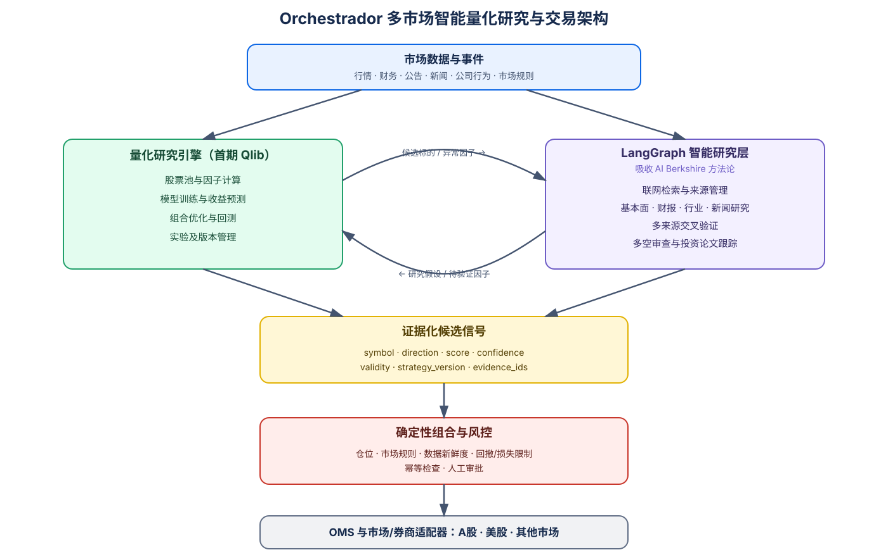

# Orchestrador

基于 FastAPI、LangChain 和 LangGraph 的统一 Agent API 服务。

## 项目目标

Orchestrador 的最终目标是构建一套面向 **多市场量化研究与交易**的智能化基座，首个落地市场为 A 股，未来可扩展至美股及其他市场。系统以 LangGraph 组织研究任务、理解公告新闻、生成并验证研究假设；以 Qlib 等确定性工具完成因子计算、模型训练、组合构建和回测；以独立的风控、订单管理和市场/券商适配层控制真实资金路径。

核心原则是：

> **量化引擎负责研究与回测，LangGraph 负责智能研究编排，独立风控服务负责审单，市场与券商适配器负责执行。**

LangGraph 是系统中的“研究员和流程调度员”，不是交易系统的最终控制器。LLM 可以生成带证据和有效期的候选信号，但不能直接决定下单数量、绕过风控或直接调用券商下单。行情采集、仓位计算、风险检查、订单状态和成交对账均由可测试、可重复的确定性程序负责。

### 目标架构



可编辑图源：[research-trading-architecture.drawio](docs/images/research-trading-architecture.drawio)。

### Qlib 与智能研究层的互补关系

Qlib 和 LangGraph/AI Berkshire 方法论不互相替代，而是分别提供量化证据和基本面证据：

| 能力 | 量化研究引擎（首期 Qlib） | LangGraph 智能研究层 |
| --- | --- | --- |
| 主要输入 | 结构化行情、财务和因子数据 | 公告、财报、新闻、研报和网页资料 |
| 核心任务 | 因子计算、模型训练、收益预测、组合优化和回测 | 联网研究、事实抽取、来源交叉验证、多空审查和投资论文跟踪 |
| 主要输出 | 可复现的因子、预测分数和回测结果 | 带引用、置信度、风险和有效期的研究结论 |
| 擅长回答 | 信号在历史和样本外是否有效 | 公司为什么值得研究，风险和变化来自哪里 |
| 不负责 | 理解复杂叙事和最终交易执行 | 代替回测、确定仓位或直接下单 |

两层形成双向研究闭环：

1. Qlib 从股票池中发现异常因子和候选标的，触发 LangGraph 深度研究。
2. LangGraph 从财报、行业和新闻中提出可量化的假设，交给 Qlib 回测验证。
3. 两侧结果汇合为标准化候选信号，必须包含策略版本、有效期和 `evidence_ids`。
4. 候选信号只能进入独立的组合与风控层，不能直接成为券商订单。

AI Berkshire 中值得吸收的是研究纪律和工作流，包括财务数据交叉验证、公司/行业/财报研究、多角色反方审查、新闻异动归因以及投资论文漂移检测；具体大师人格、内容发布和写死的数据源不进入核心架构。

### 系统边界

- LangGraph 负责研究编排、工具调用、条件分支、任务恢复和人工审批。
- Qlib 或独立 Python 服务负责数据处理、因子、模型、回测及组合计算。
- Risk Engine 必须以确定性规则检查仓位、行业暴露、换手率、价格偏差、数据新鲜度和最大亏损，并通过市场规则适配器处理 T+1、整手、涨跌停、停牌等市场特有约束。
- OMS 和 Broker Adapter 独立于 LLM 运行；即使模型服务超时或宕机，订单同步、风控和对账仍应正常工作。
- LangGraph checkpoint 只保存研究流程状态，不作为订单、持仓或账户资金的权威账本。
- 数据版本、模型版本、Prompt 版本、策略版本、信号证据、风控结果、订单请求和券商回报必须可审计。

### 第一阶段范围

第一版以 A 股日频研究作为首个验证场景，但领域模型和接口不得写死为单一市场，也不直接追求盘中高频或无人值守实盘：

1. 收盘后更新并校验行情、财务、公告和新闻数据。
2. 使用 Qlib 计算因子、模型分数并完成历史回测。
3. 使用 LangGraph 联网研究异常标的，生成带来源的候选信号。
4. 由确定性组合和风控模块生成待审批订单。
5. 先运行回测和模拟盘，保留人工审批并完成每日成交、持仓与资金对账。
6. 经数月稳定模拟、故障恢复和极端行情测试后，再评估小资金自动执行。

当前仓库仍处于 Agent API 与研究能力的基础建设阶段。现有 `chatbot`、`data_agent` 和 `mini_deep_research` 是后续目标架构的原型组件，并不代表上述交易链路已经完成。

## API 入口

统一 Python 入口为：

```text
app.main:app
```

本地启动：

```bash
python -m uvicorn app.main:app \
  --host 0.0.0.0 \
  --port 8000 \
  --workers 1
```

主要接口：

- `GET /`：数据与智能体控制台，可查看运行状态并发起 Graph 调用。
- `GET /runtime`：当前模型、端点类型、Graph 和超时配置。
- `GET /ok`：容器健康检查。
- `GET /health`：服务和 Graph 注册状态。
- `GET /graphs`：已注册 Graph 列表。
- `POST /graphs/{graph_name}/invoke`：调用指定 Graph。
- `GET /docs`：OpenAPI 文档。
- `GET /images/{filename}`：数据分析生成的图片。

调用示例：

```bash
curl -X POST http://127.0.0.1:8000/graphs/chatbot/invoke \
  -H 'Content-Type: application/json' \
  -d '{
    "input": {
      "messages": [
        {"role": "user", "content": "你好"}
      ]
    },
    "config": {
      "configurable": {"thread_id": "demo-1"}
    }
  }'
```

生产容器使用单 worker Uvicorn，并由 Docker Compose 负责健康检查和异常重启。

## 目录结构

```text
app/
├── __init__.py                         # Python 应用包
└── main.py                             # FastAPI 统一入口

bak/mini_deep_research/
├── __init__.py                         # 公共模型、提示词和组件
├── config.py                           # 正式环境配置校验
├── mini_deep_research.py               # Pipeline 实现
├── mini_deep_research_by_langGraph.py  # LangGraph 实现
```

## 安装

```bash
python -m venv venv
source venv/bin/activate
pip install -r requirements.txt
```

## 配置

正式环境应直接注入以下环境变量：

- `APP_ENV=production`
- `ANTHROPIC_API_KEY`
- `ANTHROPIC_MODEL`
- `ANTHROPIC_BASE_URL`（可选）

项目通过 Norotech Gateway 支持按请求切换以下基座模型：

- `coding-chat`（默认）
- `strong-chat`
- `cheap-chat`
- `minimax-latest`

调用 `POST /graphs/{graph_name}/invoke` 时可在 JSON 顶层传入 `model`；未传时使用
`ANTHROPIC_MODEL`。服务只接受上述白名单，前端控制台也提供对应的模型选择框。
- `TAVILY_API_KEY`

本地开发可以使用 `.env`：

```bash
cp .env.example .env
# 编辑 .env，填入真实配置
```

系统环境变量的优先级高于 `.env`，真实密钥不要提交到 Git。

## 运行 LangGraph 版本

```bash
python -m bak.mini_deep_research.mini_deep_research_by_langGraph
```

## 运行 Pipeline 版本

```bash
python -m bak.mini_deep_research.mini_deep_research
```
